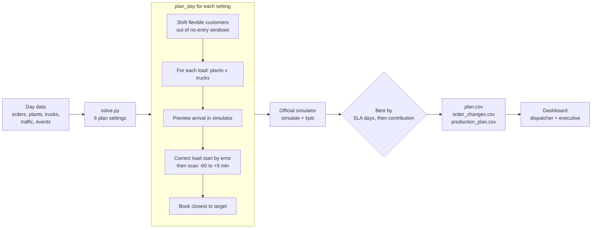
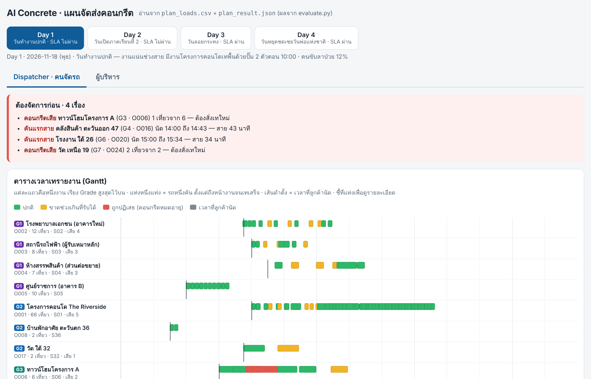

# PourSync — Ready-Mix Concrete Dispatch Planner

**A simulation-driven planner that decides the plant, truck and load-start time for ~200 concrete truckloads a day, raising SLA-compliant days from 0/4 to 2/4 and contribution by 158,724 THB (+11.9%) over the company's manual plan.**

Final-round solution for *AI Hackathon Route Optimization 2026* (top 30 of 264 teams), built in 3 hours by team **Lamnam Muen Li** on an industry case set by **SCG CPAC**.

> **Note:** the case uses the organizer's simulated data for a fictional company, *AI Concrete*. It is not real customer or company data, but it is designed to mirror real ready-mix operations.

> 🚧 **Project status: active development.** The code and results in this repo are the version submitted at the competition on **17 Oct 2026** (3-hour build), preserved as release tag [`v1.0-competition`](../../tree/v1.0-competition). I am now continuing the project to pass SLA on all 4 test days. See the [Roadmap](#roadmap).

## Table of contents
- [Overview](#overview)
- [Key Features](#key-features)
- [Results](#results)
- [Tools / Technologies](#tools--technologies)
- [Development environment](#development-environment)
- [How things work](#how-things-work)
- [How to setup](#how-to-setup)
  - [Prerequisites](#prerequisites)
  - [Generate plans](#generate-plans)
  - [Evaluate plans](#evaluate-plans)
  - [Open the dashboard](#open-the-dashboard)
- [Roadmap](#roadmap)
- [Repository structure](#repository-structure)
- [References / Useful resources](#references--useful-resources)
- [My notes](#my-notes)

## Overview
Ready-mix concrete must arrive on time and in a steady stream: it expires 120–150 minutes after loading, and a gap between trucks leaves a *cold joint* that weakens the structure. Every day the dispatcher must decide, for each of ~200 loads, **which of 8 plants loads it, which of 76 trucks carries it, and when loading starts**, under traffic, site no-entry windows, plant line capacity and drivers on leave.

PourSync makes those decisions automatically. It tests each choice in the organizer's official simulator before booking it, corrects load times from the simulated arrival error, asks flexible customers to shift when a site is closed, and finally picks the best of 6 complete plans. All rules are general, so the same code runs on the organizer's hidden test day.

Live dashboard: https://doypuy-dotcom.github.io/poursync-concrete-dispatch/viz/dashboard.html

Final-round slides: [docs/PourSync_slides.pdf](docs/PourSync_slides.pdf) (Thai)



## Key Features
- **Simulator-in-the-loop booking:** every candidate (plant × truck × time) is previewed in the official simulator before it is committed.
- **Load-start correction:** if a truck would arrive X minutes late, start loading X minutes earlier and re-check (up to 2 rounds); never earlier than the previous load of the same pour, so pour order stays valid.
- **Load-start search:** if still more than 2 minutes off, scan −60 to +9 minutes in 3-minute steps to handle traffic-period changes.
- **Customer time shifts:** for customers who allow it (`flex_type`), shift the whole pour in 5-minute steps until it no longer overlaps a site no-entry window.
- **Portfolio selection:** 6 plans (2/3/4 nearest plants × add production lines or not), ranked exactly like the competition: SLA days first, then contribution.
- **Data checks:** found 2 plant-capacity errors in the system data and verified the plan still holds with the corrected capacity.
- **Dashboard for 2 user groups:** dispatcher (priority alerts, pour Gantt chart) and executive (SLA by grade, contribution, distance, CO₂).
- **Fast:** at most ~17 s per day (limit: 5 minutes), Python standard library only.

## Results
Competition version (v1.0, 17 Oct 2026), scored by the organizer's official simulator on Days 1–4. Updated results will be added as the [Roadmap](#roadmap) progresses.

| Day | Event | SLA | Checks passed | Contribution (THB) |
|---|---|---|---|---|
| 1 | Normal weekday | ✗ | 9 / 14 | 517,561 |
| 2 | School opening (no trucks near schools 06:30–08:30) | ✗ | 10 / 14 | 349,852 |
| 3 | Loy Krathong (afternoon traffic, evening road closure) | **✓** | **14 / 14** | 403,719 |
| 4 | Public holiday (35% of drivers on leave) | **✓** | **12 / 12** | 222,713 |

| Metric | Manual plan | **PourSync** |
|---|---|---|
| Days passing SLA | 0 / 4 | **2 / 4** |
| SLA checks passed | 21 / 54 | **45 / 54** |
| Contribution (4 days) | 1,335,121 THB | **1,493,845 THB (+11.9%)** |
| Cold joints | 39 | **5** |
| Loads rejected (concrete expired) | 22 | **6** |
| Distance | 18,200 km | 23,522 km (trade-off: SLA first) |

The organizer's starter baseline also passed 0 / 4 days.



## Tools / Technologies
- Language: [Python 3](https://www.python.org/) (standard library only)
- Simulator & scoring: organizer's `aiconcrete.py` and `evaluate.py` (not included, see [Prerequisites](#prerequisites))
- Dashboard: single-file HTML / CSS / JavaScript, works offline
- Hosting: [GitHub Pages](https://pages.github.com/)
- AI assistant: Claude (code drafting and experiments; every change verified with `evaluate.py`)

## Development environment
1. Python 3.9+ (tested on 3.12)
2. Any modern browser (Chrome / Edge) for the dashboard

## How things work
1. **Load the day:** orders, customers and SLA grades, plants and line status, trucks on duty, traffic periods and events (`load_day`).
2. **Try 6 plan settings** in `solve.py`: use the 2, 3 or 4 nearest plants, with or without extra production lines.
3. **For each setting, build a plan** with `plan_day()` in `baseline_greedy.py`:
   - **A. Customer time shifts** – compute each pour's span (loads × interval); if it overlaps a site no-entry window and the customer allows shifts, move it ±5 min at a time within `flex_max_shift_min`.
   - **B. Production lines** – add lines only at plants that allow a boost, if this setting asks for it.
   - **C. Simulator** – create `Sim(day, production, changes)`.
   - **D. Targets** – arrival target for each load = first arrival + (k − 1) × interval, moved out of no-entry windows, sorted by time.
   - **E. Book each load** – try the nearest plants × allowed trucks, preview the arrival, correct the load start by the arrival error, scan if still off, then book the option closest to the target.
4. **Score each plan** with the official `simulate` + `kpis`.
5. **Pick the best plan** by `(SLA days passed, contribution)`, the same order as the competition ranking.
6. **Write the outputs:** `plan.csv`, `order_changes.csv`, `production_plan.csv`.
7. **Visualise** the plan in the dashboard for dispatchers and executives.

## How to setup

### Prerequisites
The simulator and competition data belong to the organizers and are not in this repo. You need the *AI Concrete Student Kit*:
```bash
git clone https://github.com/doypuy-dotcom/poursync-concrete-dispatch.git
cd poursync-concrete-dispatch
cp <kit>/starter/aiconcrete.py code/
```

### Generate plans
```bash
cd code
python solve.py <kit>/data/day3_festival ../out/day3
```

### Evaluate plans
```bash
python <kit>/starter/evaluate.py <kit>/data/day3_festival ../out/day3/plan.csv \
  --changes ../out/day3/order_changes.csv --production ../out/day3/production_plan.csv
```

### Open the dashboard
Double-click `viz/dashboard.html` (no server or internet needed), or enable **Settings → Pages → main / root** and open the live link above.

## Roadmap
Competition result (v1.0): **2 / 4 days** pass SLA, 45 / 54 checks. On Days 1–2 every on-time check already passes; **all remaining failures are pour continuity** (gaps between trucks of the same pour, mainly large G1–G2 pours that start at the same time on Day 1).

| Status | Step | Goal |
|---|---|---|
| ⬜ | Diagnostic report: for each broken pour, which load caused the gap and why | Fix the real cause, not the symptom |
| ⬜ | Fix edge case when no feasible option exists for a load (`best is None`) | Never crash on the hidden day |
| ⬜ | Set each load's target from the previous load's actual pour end, not a fixed schedule | Raise continuity on Days 1–2 |
| ⬜ | Repair loop: remove the loads of broken pours, re-insert them, keep only if SLA improves | Fix the pours that are still broken |
| ⬜ | Let G1–G2 pours reserve trucks first; reposition idle trucks earlier | Protect the strictest customers |
| ⬜ | Re-test with corrected plant capacity and the 5-minute limit; update results | Same code for every day, no day-specific rules |

**Target:** pass SLA on **4 / 4 days**. Progress and results for each step will be logged here and in [notes/README.md](notes/README.md).

## Repository structure
```
code/solve.py            entry point: 6 candidate plans, keep the best
code/baseline_greedy.py  plan_day(): time shifts, load-start correction & search, booking
viz/dashboard.html       dispatcher + executive dashboard (offline, single file)
viz/README.md            dashboard design notes (Thai)
docs/APPROACH.md         approach write-up submitted to judges (Thai)
docs/PourSync_slides.pdf final-round slides (Thai)
images/                  figures used in this README
notes/                   design notes, what did not work, next steps
```

## References / Useful resources
- AI Hackathon Route Optimization 2026 – AI Concrete Student Kit & Data Book (organizer material, simulated data)
- Schmid, V. et al. (2009). *A hybrid solution approach for ready-mixed concrete delivery.* Transportation Science.

## My notes
What worked, what did not, and the next steps for Days 1–2 are in [notes/README.md](notes/README.md).

---
Team **Lamnam Muen Li**: Kongphob Onnom (Robotics & AI Engineering, KMITL) and teammates. `baseline_greedy.py` extends the organizer's starter baseline. Case and data: AI Hackathon Route Optimization 2026 / SCG CPAC (simulated data).
